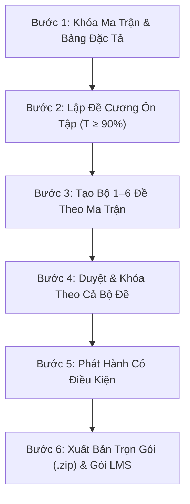

# 📖 CẨM NANG HƯỚNG DẪN SỬ DỤNG HỆ THỐNG EXAMMATRIX STUDIO
### VÀ QUY CHUẨN LOẠI & ĐỊNH DẠNG DỮ LIỆU ĐẦU VÀO
**Đơn vị:** Trường Tiểu học, THCS & THPT Quốc tế Á Châu (Asian School)  
**Phạm vi áp dụng:** Giáo viên các bộ môn (Tin học, Toán học, Vật lí, Hóa học, Sinh học, Ngữ văn, Lịch sử, Địa lí, Tiếng Anh) và Tổ chuyên môn Khối 8, 9, 10, 11, 12.

---

## PHẦN 1. QUY TRÌNH RA ĐỀ KHẢO THÍ 6 BƯỚC KHÉP KÍN (WIZARD 6 BƯỚC)

Hệ thống ExamMatrix Studio vận hành theo chu trình chuẩn hóa khép kín 6 bước (Milestone C1 & C2):



### Chi tiết 6 bước thực hiện trên giao diện Web:

| Bước | Tên Bước | Vị trí trên web | Các thao tác của Giáo viên / Tổ trưởng | Kết quả đầu ra | Ràng buộc nghiệp vụ bắt buộc |
|:---:|:---|:---|:---|:---|:---|
| **B1** | **Khóa Ma trận & Bảng đặc tả** | Tab `Ma trận & Đặc tả` | 1. Chọn Môn, Khối, Kỳ kiểm tra (GK1, CK1, GK2, CK2, TX).<br>2. Nhập số câu theo ô (Bài $\times$ Mức độ $\times$ Dạng câu).<br>3. Kiểm tra cân bằng tổng điểm $10.0$.<br>4. Bấm `Khóa ma trận`. | Ma trận và Bảng đặc tả chính thức ở trạng thái `locked`. | Số câu dạng thuần số `(1, 2, 3)` (Rule 2). Ghi số câu ở cuối YCCĐ. Bảng rộng $\le 24\text{ cm}$ (Rule 3). |
| **B2** | **Lập Đề cương ôn tập** | Tab `Đề cương ôn tập` | 1. Bấm `Lập đề cương theo ma trận`.<br>2. Chọn số lượng câu từng ô hoặc tổng số câu dự kiến.<br>3. Xem đối chiếu ma trận, kiểm tra độ phủ YCCĐ $100\%$.<br>4. Lưu nháp đề cương. | Bản đề cương ôn tập kèm ngân hàng câu hỏi ôn luyện. | Bảng "A. Giới hạn kiến thức" đúng 3 cột: `STT \| Tên chủ đề \| Tên bài` (Rule 5). Logo banner đặt giữa rộng $\approx 13,5\text{ cm}$. |
| **B3** | **Tạo bộ đề theo ma trận** | Tab `Tạo đề thi` | 1. Chọn Ma trận đã khóa ở B1.<br>2. Chọn đề cương có sẵn hoặc để hệ thống tự lập; chọn **1–6 đề** trong bộ.<br>3. Bấm `Tạo bộ đề`, xem báo cáo và cảnh báo câu dùng chung. | Bộ các đề gốc, ưu tiên khác câu; có thể dùng chung câu khi nguồn câu hoặc đề cương chưa đủ lớn. | Mỗi đề phải đạt tiêu chí đề cương trước khi duyệt. Các mã hoán vị 101–104 của từng đề được tạo bằng thao tác riêng ở B6. |
| **B4** | **Kiểm duyệt & Khóa cả bộ** | Tab `Tạo đề thi` $\rightarrow$ Thẻ Bộ đề | 1. Giáo viên ra đề bấm `Gửi duyệt cả bộ` (`submit`).<br>2. Tổ trưởng chuyên môn thẩm định câu hỏi và barem.<br>3. Tổ trưởng bấm `Duyệt & Khóa cả bộ` (`approve`). | Thao tác `approve` đưa cả bộ đề trực tiếp sang `locked` với giao dịch nguyên tử; API chuyển trạng thái đề không có thao tác `lock` riêng. | Giao dịch nguyên tử: nếu 1 đề trong bộ lỗi, toàn bộ được rollback an toàn. Đề đã khóa được chốt snapshot nội dung & mã băm SHA-256. |
| **B5** | **Phát hành có điều kiện** | Tab `Đề cương` & Tab `Đề thi` | 1. Bấm `Phát hành đề cương` (`publish`) gửi học sinh.<br>2. Đến ngày thi, bấm `Phát hành bộ đề thi` (`publish`). | Trạng thái chuyển sang `published`. | **Luật bất biến:** Hệ thống tự động CHẶN phát hành đề cương nếu bộ đề thi căn cứ chưa được duyệt và khóa. |
| **B6** | **Xuất bản & Tải Hồ sơ (.zip)** | Nút tải tại trang chi tiết Đề thi | 1. Với từng đề gốc, dùng thao tác tạo mã hoán vị 101–104 khi cần xáo trộn thứ tự câu và phương án.<br>2. Bấm `Tải gói hồ sơ (.zip)` và đọc báo cáo đóng gói bên trong.<br>3. Xuất riêng tệp LMS khi cần. | ZIP có số tệp tùy số mã đề, định dạng và thành phần xuất được; không cố định 12 tệp. Tệp LMS xuất riêng. | Đề học sinh không có đáp án. Đối chiếu bố cục với quy chuẩn trước khi dùng chính thức; xem cảnh báo thành phần thiếu hoặc lỗi trong báo cáo ZIP. |

Chuyển DOCX sang PDF cần máy cục bộ có Microsoft Word và quyền tự động hóa phù hợp. Bản online vẫn xuất DOCX; không mặc định ZIP có đồng thời Word và PDF. Có thể tạo đề nháp chưa gắn đề cương rồi chọn đề cương khi kiểm định; duyệt chính thức vẫn phải đạt tiêu chí đề cương.

---

## PHẦN 2. CÁC LUỒNG CÔNG TÁC PHỤ TRỢ

### 2.1. Quản lý Ngân hàng câu hỏi & Vòng đời Thẩm định
- **Vòng đời 4 trạng thái:** `draft` (Bản nháp) $\rightarrow$ `content_checked` (Đã soát nội dung) $\rightarrow$ `approved` (Đã phê duyệt) $\rightarrow$ `needs_review` (Cần chỉnh sửa lại).
- **Cơ chế an toàn:** Khi một câu hỏi đã duyệt (`approved`) bị bất kỳ ai sửa nội dung, hệ thống sẽ **tự động chuyển trạng thái về `needs_review`** để ngăn chặn việc lọt câu hỏi chưa được thẩm định lại vào đề thi chính thức.
- **Báo cáo thiếu câu B9 (Shortfall Report):** Báo cáo cảnh báo trực quan số câu còn thiếu của từng ô (bài $\times$ YCCĐ $\times$ dạng câu $\times$ mức độ).

### 2.2. Đánh giá Thường xuyên (KTTX theo TT 22/2021 Điều 6)
- **Quy định số lượng:** Cấp THCS (35 tiết/năm): 2 ĐĐGtx/học kỳ; Cấp THPT (70 tiết/năm): 3 ĐĐGtx/học kỳ.
- **Cụm chuyên đề học tập THPT (Điều 6.3):** Tính là 01 lần ĐGtx riêng biệt.
- **Tiêu đề chuẩn hóa:** `Tin {Khối}_Kiểm tra thường xuyên {k} - HK {I|II}` kèm tên lớp (ví dụ: `Tin 8_Kiểm tra thường xuyên 1 - HK I 8A1`).

---

## PHẦN 3. QUY CHUẨN LOẠI DỮ LIỆU & ĐỊNH DẠNG ĐẦU VÀO (INPUT SPECIFICATIONS)

### 3.1. Cấu trúc câu hỏi ngân hàng (Question JSON Schema)

| Tên trường | Kiểu dữ liệu | Bắt buộc | Mô tả & Quy cách định dạng |
|:---|:---|:---:|:---|
| `subject_name` | String | **Có** | Tên môn học chính xác: `"Tin học"`, `"Toán học"`, `"Vật lí"`, `"Hóa học"`, `"Sinh học"`, `"Ngữ văn"`, `"Lịch sử"`, `"Địa lí"`, `"Tiếng Anh"`. |
| `grade` | Integer | **Có** | Khối lớp: `8`, `9`, `10`, `11`, hoặc `12`. |
| `lesson_code` | String | **Có** | Mã bài học trong PPCT (ví dụ: `"B1"`, `"B2"`, `"B12"`, `"U1"`). |
| `type` | String | **Có** | Dạng câu hỏi: `"MC"` (Nhiều lựa chọn), `"YN"` (Đúng/Sai), `"SHORT"` (Trả lời ngắn), `"ES"` (Tự luận). |
| `cognitive_level` | String | **Có** | Mức độ nhận thức: `"Biết"`, `"Hiểu"`, `"Vận dụng"`, hoặc `"Vận dụng cao"`. |
| `learning_outcome` | String | **Có** | Yêu cầu cần đạt chuẩn GDPT 2018 (lấy từ PPCT môn học). |
| `question` | String | **Có** | Nội dung câu hỏi (chấp nhận văn bản thường, công thức $\LaTeX$, khối code, bảng markdown). |
| `options` | Array[4] | Với MC | Mảng đúng 4 chuỗi phương án `[A, B, C, D]`. Không được để trống phương án nào. |
| `correct` | Integer | Với MC | Chỉ số đáp án đúng: `0` (A), `1` (B), `2` (C), `3` (D). |
| `statements` | Array[4] | Với YN | Mảng 4 nhận định `[ {label: "a", text: "...", correct: true/false}, ... ]` (Khối 10). |
| `short_answer` | String | Với SHORT | Chuỗi đáp án ngắn chính xác (ví dụ: `"5"`, `"CPU"`). |
| `rubric` | Array | Với ES | Mảng các bước chấm `[ {step: "...", points: 0.5}, ... ]` với tổng điểm khớp câu hỏi. |
| `fixed_order_options`| Boolean | Không | Đặt `true` nếu các phương án không được đảo thứ tự (chứa "Cả A và B đều đúng"). |
| `review_status` | String | **Có** | Trạng thái thẩm định: `"draft"`, `"content_checked"`, `"approved"`, `"needs_review"`. |

---

### 3.2. Quy chuẩn Định dạng File Trắc nghiệm Upload lên LMS (Rule 6)

Tuân thủ nghiêm ngặt **Quy chuẩn 06 của Nhà trường**:
1. **Không để bảng đáp án** ở cuối file.
2. **Đáp án đúng:** Nhãn phương án được in đậm và đặt trong dấu ngoặc vuông: **`[A.] `**, **`[B.] `**, **`[C.] `**, **`[D.] `** (nội dung phương án viết bình thường, không chèn các nhãn thừa như `[ĐÁP ÁN ĐÚNG]`).
3. **Phương án sai:** Nhãn phương án viết bình thường không ngoặc vuông: `A. `, `B. `, `C. `, `D. `.
4. **Dạng thức Đúng/Sai (Khối 10):**
   - Ý đúng: **`[a)] `** `Nội dung nhận định [ĐÚNG]`
   - Ý sai: `b) ` `Nội dung nhận định [SAI]`
5. **Dạng thức Trả lời ngắn:**
   - Dòng đáp án đặt ngay dưới câu hỏi, in đậm và đóng ngoặc vuông: **`[Đáp án: 2]`** hoặc **`[Đáp án: CPU]`**.

*Ví dụ trích đoạn file LMS chuẩn:*
```text
Câu 1: RAM là loại bộ nhớ gì trong máy tính?
[A.] Bộ nhớ truy cập ngẫu nhiên, dữ liệu bị mất khi mất điện.
B. Bộ nhớ chỉ đọc, dữ liệu không bị mất khi mất điện.
C. Bộ nhớ ngoài dung lượng lớn.
D. Bộ nhớ đệm tốc độ cao nằm trong CPU.

Câu 2: Các nhận định sau về an toàn thông tin:
[a)] Cần bật xác thực hai yếu tố (2FA) để bảo vệ tài khoản cá nhân. [ĐÚNG]
b) Mật khẩu đơn giản như "123456" là đủ an toàn khi dùng mạng nội bộ. [SAI]
[c)] Không mở các tệp đính kèm thư điện tử từ người gửi không xác định. [ĐÚNG]
d) Được phép chia sẻ tài khoản LMS cho người ngoài lớp sử dụng. [SAI]

Câu 3: Kết quả của biểu thức (17 MOD 5) + (17 DIV 5) trong Pascal bằng bao nhiêu?
[Đáp án: 5]
```

---

### 3.3. Quy chuẩn Đề cương ôn tập — Bảng "A. Giới hạn kiến thức ôn tập" (Rule 5)

- Bảng giới hạn chỉ gồm đúng **3 cột**:
  1. **STT** (Số thứ tự 1, 2, 3...)
  2. **Tên chủ đề** (Chuẩn theo Ma trận & KHDH chính thức)
  3. **Tên bài** (Chuẩn theo Ma trận & KHDH chính thức)
- Tuyệt đối không thêm cột thời lượng, số tiết, hay mục tiêu bài học vào bảng này.
- Logo trường là banner đặt chính giữa trang, rộng khoảng $13,5\text{ cm}$.

---

## PHẦN 4. BẢO MẬT & SAO LƯU DỮ LIỆU

1. **Bảo mật đề thi:** Tài khoản học sinh hoặc chế độ xem đề học sinh tuyệt đối không được truy cập hay tải về tệp đáp án chi tiết hoặc bảng đáp án tổng hợp (trả về HTTP 403 Forbidden).
2. **Sao lưu dữ liệu cục bộ (Lệnh A8):**
   ```bash
   cd cloud
   python manage.py backup_local
   python manage.py verify_backup var/backups/<thu_muc_sao_luu>
   ```
   Lệnh `verify_backup` kiểm tra tính toàn vẹn của bản sao lưu (tệp, mã băm và đối chiếu dữ liệu). Muốn xác nhận khả năng khôi phục, cần diễn tập `restore_local` riêng trong môi trường cách ly; kết quả verify đạt chưa thay thế diễn tập phục hồi.


## Biên soạn mã và bảng cho đề giữa học kì

Trong Ngân hàng câu hỏi, chọn Thêm hoặc Sửa câu hỏi. Dùng **Chèn mã** hoặc **Chèn bảng**, điền nội dung vào mẫu văn bản và kiểm tra ngay khung xem trước. Khối mã giữ thụt dòng; bảng có hàng tiêu đề và hàng phân cách hợp lệ sẽ thành bảng trong bản xem và Word. Cú pháp chưa đủ được giữ nguyên văn.

Muốn đổi nội dung mã/bảng, hãy sửa ở cửa sổ biên soạn câu hỏi; công cụ định dạng bản xem không thay dữ liệu bên trong các khối nguồn này. Câu đã duyệt được sửa sẽ cần duyệt lại; đề đã khóa giữ bản chụp cũ. Chọn lại câu hoặc tạo bản đề mới theo quy trình hiện hành.

Trả lời ngắn được hiển thị trong đề và đề cương theo ma trận. Bản học sinh có chỗ trả lời; bản giáo viên có đáp án. Bảng giới hạn kiến thức của đề cương có ba cột STT, Tên chủ đề, Tên bài.

Các chỉnh trình bày chỉ lưu cục bộ ở bản cũ không tự nạp lại sau bản sửa này; nội dung câu và bản nháp trên máy chủ giữ nguyên. Hiện chưa hỗ trợ chuyển chuỗi LaTeX thành công thức Word gốc hoặc nhúng ảnh/đồ thị vào câu hỏi. Nếu ứng dụng đã mở từ trước, khởi động lại để nạp backend mới.
