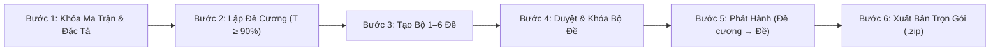

# Ngân hàng đề & Khảo thí Trực tuyến (ExamMatrix Studio)

> **Hệ thống Quản lý Khảo thí, Ngân hàng câu hỏi, Ma trận & Biên soạn Đề thi chuẩn GDPT 2018**  
> Dành cho Giáo viên và Tổ Chuyên môn — Trường Quốc tế Á Châu (Asian School).

Ứng dụng web đa người dùng (Multi-tenant Django + SPA Frontend) giúp tổ bộ môn Tin học và các môn khoa học quản lý toàn diện quy trình kiểm tra đánh giá: từ Phân phối chương trình (PPCT), Ngân hàng câu hỏi đa dạng (MC, Đúng/Sai YN, Trả lời ngắn SHORT, Tự luận ES), lập Ma trận & Bảng đặc tả, Đề cương ôn tập, đến tạo bộ 1–6 đề theo ma trận, sinh mã hoán vị 101–104 cho từng đề, Bảng đáp án tổng hợp và xuất hồ sơ Word. Chuyển Word sang PDF cần máy cục bộ có Microsoft Word và quyền tự động hóa phù hợp; bản online vẫn xuất DOCX.

---

## 🚀 Khởi chạy Nhanh trên Máy Cục bộ (Local)

Yêu cầu môi trường: **Python 3.11+** và Node.js 18+.

```bash
# 1. Kích hoạt môi trường ảo
python3 -m venv .venv
source .venv/bin/activate
pip install -r cloud/requirements.lock

# 2. Khởi tạo Cơ sở dữ liệu
cd cloud
../.venv/bin/python manage.py migrate

# 3. Khởi chạy máy chủ phát triển
../.venv/bin/python manage.py runserver 127.0.0.1:8877
```

- Mở trình duyệt tại: `http://127.0.0.1:8877/accounts/signup/` để đăng ký tài khoản giáo viên.
- Sau khi đăng nhập, hệ thống tự động điều hướng tới không gian làm việc chuyên môn (`/app/`).
- Dữ liệu cục bộ được phân tách an toàn trong `cloud/var/` (loại khỏi Git, bảo mật theo Luật Nhà giáo và NĐ 356/2025).

---

## 📋 Tính năng Cốt lõi & Quy trình Ra đề 6 Bước (Milestone C1 & C2)

Hệ thống được thiết kế theo đúng chu trình khảo thí khép kín 6 bước:



1. **Bước 1 — Ma trận & Bảng đặc tả 4 mức độ:** Thiết lập chuẩn Biết, Hiểu, Vận dụng, Vận dụng cao. Tự động cân bằng điểm 10.0, kiểm tra tính khả thi của ngân hàng câu hỏi.
2. **Bước 2 — Đề cương ôn tập:** Lập đề cương bám sát ma trận. Tiêu chí ràng buộc: Đề thi thật phải lấy tối thiểu $90\%$ câu hỏi trong đề cương ($T \ge 90\%$). Bảng giới hạn kiến thức chuẩn 3 cột (`STT | Tên chủ đề | Tên bài`).
3. **Bước 3 — Tạo bộ 1–6 đề:** Chọn số đề và đề cương có sẵn hoặc để hệ thống tự lập theo ma trận. Hệ thống ưu tiên các đề khác câu; nếu nguồn câu hoặc đề cương chưa đủ lớn, các đề có thể dùng chung câu và có cảnh báo. Sau đó, với từng đề gốc, dùng thao tác hoán vị riêng để tạo các mã 101, 102, 103, 104: xáo trộn ngẫu nhiên thứ tự câu hỏi và các phương án A, B, C, D; tự động bảo vệ các câu chứa phương án cố định ("Cả A và B", "Tất cả các phương án trên").
4. **Bước 4 — Duyệt & Khóa theo cả bộ đề (`/api/exams/set/transition`):** Giao dịch nguyên tử, chuyển trạng thái đồng loạt cho các đề trong bộ: `submit` đưa sang chờ duyệt, `approve` đưa thẳng sang `locked`. API chuyển trạng thái đề không có thao tác `lock` riêng. Khóa chặt snapshot nội dung và mã băm SHA-256 (sửa ngân hàng gốc không làm lệch đề thi đã khóa).
5. **Bước 5 — Phát hành có điều kiện (`/api/revisions/transition`):** Áp dụng luật bất biến: Chặn phát hành đề cương ôn tập nếu bộ đề thi căn cứ chưa được duyệt và khóa.
6. **Bước 6 — Xuất bản Hồ sơ Khảo thí & Gói LMS 1-Click:**
   - **Tệp Word học sinh (`.docx`):** Đánh số liên tục, font Times New Roman, khổ ngang Landscape $\le 24\text{ cm}$, tuyệt đối không lộ đáp án ở cuối bài.
   - **Đáp án chi tiết & Barem điểm:** Hướng dẫn chấm từng bước.
   - **Bảng đáp án tổng hợp (`Master Answer Grid`):** Ma trận đối soát 4 mã đề trong 1 trang giấy phục vụ chấm thi tập trung.
   - **Bảng đối chiếu hoán vị:** Truy vết vị trí câu gốc sang các mã đề.
   - **Số tệp ZIP:** Phụ thuộc số mã đề, định dạng và thành phần xuất được; đọc `Bao_cao_dong_goi_ho_so.txt` trong gói để biết phần thiếu hoặc lỗi, không mặc định luôn có 12 tệp.
   - **Gói LMS trắc nghiệm:** Xuất tệp Aiken Text (`.txt`) và Word LMS (`.docx`) chuẩn Quy tắc 06 (đáp án đúng đóng ngoặc vuông `[A.]`, không bảng đáp án cuối trang).

---

## 🛠️ Nghiệp vụ Chuyên sâu Tích hợp

- **Quản lý KTTX (Thông tư 22/2021 Điều 6):** Phân biệt rõ đầu điểm ghi sổ (THCS 2 bài/kỳ; THPT 3 bài/kỳ) với hoạt động kiểm tra thường xuyên; hỗ trợ cụm chuyên đề học tập THPT (Điều 6.3).
- **Vòng đời Thẩm định Câu hỏi:** Quy trình gửi và duyệt (`draft` $\rightarrow$ `pending_review` $\rightarrow$ `approved`). Câu đã duyệt khi bị sửa nội dung sẽ tự động chuyển về `needs_review` để tránh lọt câu chưa thẩm định.
- **Báo cáo Thiếu hụt Ngân hàng (B9 Shortfall Report):** Thống kê theo từng ô (bài $\times$ YCCĐ $\times$ dạng câu $\times$ mức độ), cảnh báo tức thì khi ngân hàng thiếu câu hỏi đã duyệt.
- **Sao lưu & Toàn vẹn Dữ liệu (A8):** Lệnh quản trị `python manage.py backup_local` và `python manage.py verify_backup` xác thực mã băm SHA-256 của từng tệp tin và cơ sở dữ liệu.

---

## 🧪 Kiểm thử Hệ thống (Automated Test Suites)

Chạy các bộ kiểm thử sau từ thư mục gốc repository. Kết quả test tự động không thay xác nhận nghiệp vụ của giáo viên:

```bash
# 1. Kiểm thử Kịch bản Giáo viên C2 & Engine Core
.venv/bin/python -m unittest discover -s tests

# 2. Kiểm thử Vòng đời Bộ đề C1
.venv/bin/python -m unittest tests/test_exam_set.py

# 3. Kiểm thử Django Cloud & Sao lưu
cd cloud
../.venv/bin/python manage.py test --noinput
../.venv/bin/python manage.py makemigrations --check --dry-run

# 4. Kiểm thử Logic Giao diện Frontend
cd ..
node tests/frontend.test.cjs
node tests/matrices_frontend.test.cjs
```

---

## 🌐 Triển khai Đám mây (Cloud Deployment)

- **Web Server:** Render (Web Service kết nối trực tiếp GitHub).
- **Cơ sở dữ liệu:** Neon PostgreSQL (Serverless Postgres tại khu vực gần Singapore).
- Hướng dẫn chi tiết xem tại [deploy/README.md](deploy/README.md).
