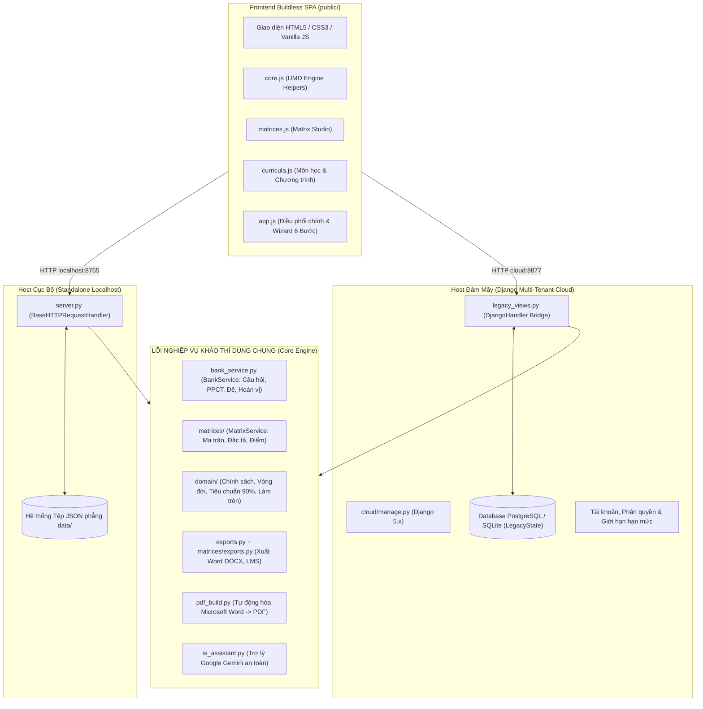
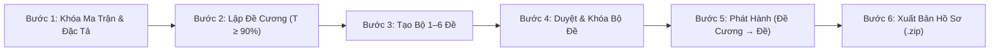
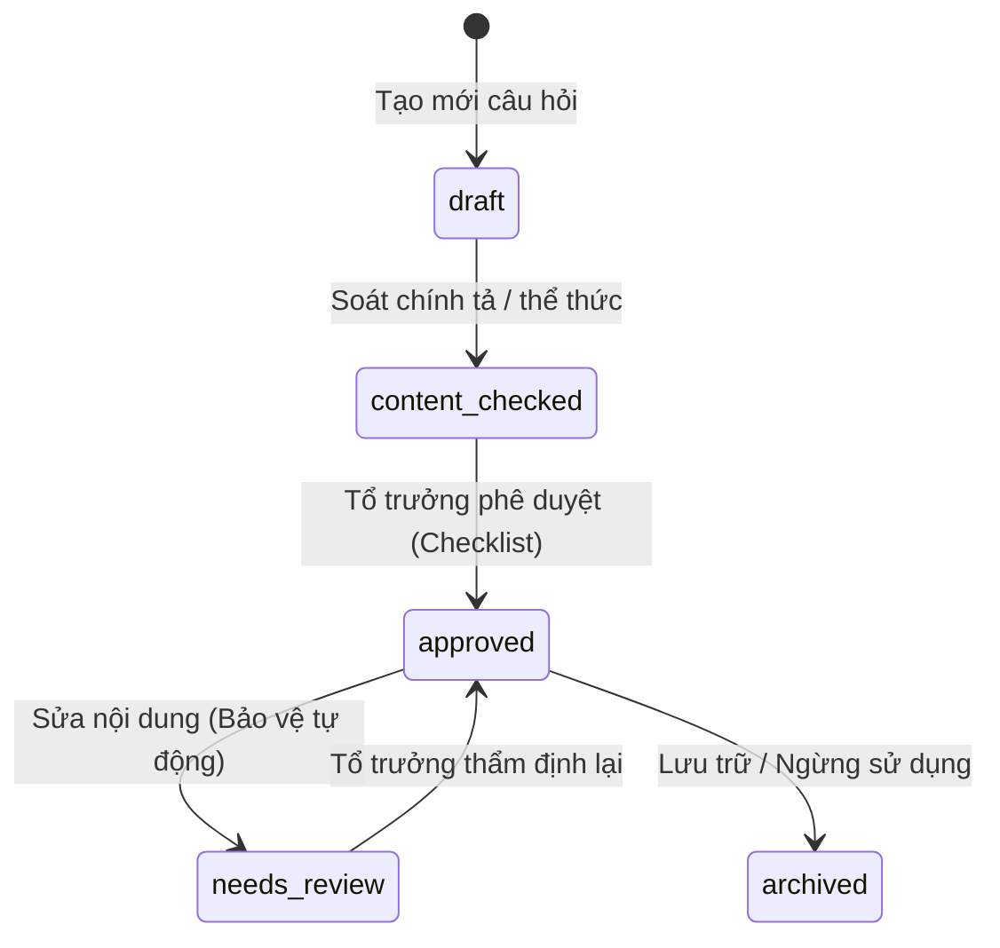

# BÁO CÁO TỔNG QUAN TOÀN BỘ DỰ ÁN HỆ THỐNG KHẢO THÍ & NGÂN HÀNG ĐỀ TRỰC TUYẾN
## ExamMatrix Studio — Hệ Thống Quản Lý Khảo Thí, Ma Trận, Đề Cương & Đề Thi Chuẩn GDPT 2018

> **Đơn vị áp dụng:** Trường Tiểu học, THCS & THPT Quốc tế Á Châu (Asian School)  
> **Bộ môn nòng cốt:** Tin học (Khối 8, 9, 10) & Hỗ trợ đa môn (Toán học, Vật lí, Hóa học, Sinh học...)  
> **Cập nhật hiện trạng:** Tháng 11/2026 (Hoàn tất Mốc C1, C2 — Chu trình 6 bước khép kín & Vận hành thực nghiệm)

---

## MỤC LỤC TỔNG QUAN

1. [Giới Thiệu & Bối Cảnh Dự Án](#1-giới-thiệu--bối-cảnh-dự-án)
2. [Căn Cứ Pháp Lý & Quy Chuẩn Chuyên Môn Chi Phối](#2-căn-cứ-pháp-lý--quy-chuẩn-chuyên-môn-chi-phối)
3. [Kiến Trúc Kỹ Thuật Hệ Thống ("Một Lõi, Hai Máy Chủ")](#3-kiến-trúc-kỹ-thuật-hệ-thống-một-lõi-hai-máy-chủ)
4. [Cấu Trúc Thư Mục & Phân Hệ Cốt Lõi](#4-cấu-trúc-thư-mục--phân-hệ-cốt-lõi)
5. [Quy Trình Ra Đề Khảo Thí 6 Bước Khép Kín (Wizard C1 & C2)](#5-quy-trình-ra-đề-khảo-thí-6-bước-khép-kín-wizard-c1--c2)
6. [Hệ Thống Quy Tắc Nghiệp Vụ Bất Biến (Domain Invariants)](#6-hệ-thống-quy-tắc-nghiệp-vụ-bất-biến-domain-invariants)
7. [Quy Chuẩn Xuất Bản Hồ Sơ & Gói LMS](#7-quy-chuẩn-xuất-bản-hồ-sơ--gói-lms)
8. [Tích Hợp Trí Tuệ Nhân Tạo (Gemini AI Assistant)](#8-tích-hợp-trí-tuệ-nhân-tạo-gemini-ai-assistant)
9. [Đặc Tả Hệ Thống API RESTful](#9-đặc-tả-hệ-thống-api-restful)
10. [Hộp Cát Kiểm Thử (Test Sandbox Mode) & Dữ Liệu Mẫu](#10-hộp-cát-kiểm-thử-test-sandbox-mode--dữ-liệu-mẫu)
11. [Chiến Lược Kiểm Thử Tự Động (Automated Test Suites)](#11-chiến-lược-kiểm-thử-tự-động-automated-test-suites)
12. [Hướng Dẫn Vận Hành & Triển Khai (Local & Cloud)](#12-hướng-dẫn-vận-hành--triển-khai-local--cloud)

---

## 1. GIỚI THIỆU & BỐI CẢNH DỰ ÁN

### 1.1. Mục đích ra đời
Dự án **Ngân hàng đề & Khảo thí trực tuyến (`ngan-hang-de-web`)**, tên thương mại **ExamMatrix Studio**, là hệ thống phần mềm chuyên biệt phục vụ công tác kiểm tra đánh giá định kỳ và thường xuyên dành cho giáo viên và tổ chuyên môn tại **Trường Quốc tế Á Châu (Asian School)**.

Hệ thống số hóa toàn bộ chuỗi mắt xích nghiệp vụ sư phạm khép kín:
$$\text{PPCT / YCCĐ} \longrightarrow \text{Ngân hàng câu hỏi} \longrightarrow \text{Thẩm định} \longrightarrow \text{Ma trận \& Bảng đặc tả} \longrightarrow \text{Đề cương} \longrightarrow \text{Bộ đề 1–6 đề} \longrightarrow \text{Hoán vị 101–104} \longrightarrow \text{Hồ sơ Word/PDF/LMS}$$

### 1.2. Mục tiêu trọng tâm
- **Tính chuẩn xác pháp lý:** Tuân thủ triệt để các Thông tư của Bộ GD&ĐT (TT 22/2021, TT 32/2018), Công văn hướng dẫn cấu trúc đề thi mới (CV 7991/BGDĐT-GDTrH) và Quy định chuyên môn của Trường Quốc tế Á Châu.
- **Tính toàn vẹn dữ liệu:** Mọi câu hỏi trong đề thi chính thức bắt buộc phải truy vết được về câu hỏi đã được Tổ chuyên môn phê duyệt (`approved`), bảo vệ bằng mã băm SHA-256 chống sửa đổi ngoài ý muốn.
- **Ràng buộc sư phạm 90%:** Đề thi chính thức phải có tối thiểu $90\%$ câu hỏi trùng hoặc bám sát đề cương ôn tập đã phát hành cho học sinh ($T \ge 90\%$).
- **Tự động hóa hoàn toàn:** Tự động sinh mã đề hoán vị (101, 102, 103, 104), tự động tạo bảng ma trận đáp án tổng hợp (Master Answer Grid), tự động đóng gói hồ sơ khảo thí chuẩn in ấn A4 ngang không tràn lề.

---

## 2. CĂN CỨ PHÁP LÝ & QUY CHUẨN CHUYÊN MÔN CHI PHỐI

Hệ thống được thiết kế dựa trên các căn cứ pháp lý và quy chuẩn nội bộ nghiêm ngặt:

| Văn bản / Quy chuẩn | Nội dung áp dụng trong phần mềm | Mã module xử lý |
| :--- | :--- | :--- |
| **Thông tư 22/2021/TT-BGDĐT** (Điều 5) | Điểm kiểm tra định kỳ (Giữa kỳ GK, Cuối kỳ CK) làm tròn đến **1 chữ số thập phân** ($0,1$). | `domain/scoring.py` |
| **Thông tư 22/2021/TT-BGDĐT** (Điều 6) | Số lần kiểm tra thường xuyên (ĐĐGtx) trong học kỳ: 2 lần (môn $\le 35$ tiết/năm như Tin THCS), 3 lần (môn $\le 70$ tiết/năm như Tin THPT); cụm chuyên đề tính 01 lần ĐGtx riêng. Điểm KTTX làm tròn đến **số nguyên**. | `domain/kttx.py` |
| **Thông tư 32/2018/TT-BGDĐT** | Khung chuẩn kiến thức môn Tin học (THCS 35 tiết/năm, THPT 70 tiết/năm) và chuẩn Yêu cầu cần đạt (YCCĐ). | `ppct_import.py`, `bank_service.py` |
| **Công văn 7991/BGDĐT-GDTrH** | Cấu trúc đề kiểm tra đánh giá định kỳ: 4 mức độ nhận thức (Biết, Hiểu, Vận dụng, Vận dụng cao); 4 dạng thức câu hỏi (MC, YN 4 ý, SHORT, ES); thang điểm bậc thang câu Đúng/Sai. | `domain/profiles.py`, `domain/scoring.py` |
| **Quy tắc 01 (`rules/01`)** | Nguyên tắc ra đề: Đề thi thật phải bám sát đề cương ôn tập với tỷ lệ $T \ge 90\%$ và độ phủ YCCĐ đạt $100\%$. | `domain/revision_criterion.py` |
| **Quy tắc 02 (`rules/02`)** | Đánh số câu hỏi: Ma trận phải ghi danh sách câu cụ thể `(1, 2, 3)` hoặc `(1a, 1b)`, cấm ghi dải câu `(C1 - C4)`. Đặc tả ghi số câu ở cuối YCCĐ. | `matrices/exports.py`, `matrices/generation.py` |
| **Quy tắc 03 (`rules/03`)** | Định dạng in ấn: Khổ ngang Landscape A4, bảng rộng $\le 24,0\text{ cm}$, font Times New Roman, lề chuẩn, không tràn viền. **Logo chỉ xuất hiện trên Đề cương ôn tập, tuyệt đối không có logo trên Đề thi và Ma trận.** | `exports.py`, `matrices/exports.py` |
| **Quy tắc 05 (`rules/05`)** | Đề cương ôn tập: Mục A "Giới hạn kiến thức ôn tập" chuẩn cấu trúc đúng 3 cột (`STT \| Tên chủ đề \| Tên bài`). | `exports.py`, `domain/revision_criterion.py` |
| **Quy tắc 06 (`rules/06`)** | Định dạng tệp trắc nghiệm LMS: Đáp án đúng đóng ngoặc vuông `[A.]`, không để bảng đáp án ở cuối trang. | `exports.py`, `lms-question-bank-converter` |
| **Luật Nhà giáo (Luật 91/2025/QH15) & NĐ 356/2025/NĐ-CP** | Phân tách dữ liệu giáo viên an toàn, bảo vệ dữ liệu hồ sơ cá nhân và bí mật ngân hàng đề thi. | `cloud/assessment/legacy_storage.py` |

---

## 3. KIẾN TRÚC KỸ THUẬT HỆ THỐNG ("MỘT LÕI, HAI MÁY CHỦ")

Hệ thống được thiết kế theo mô hình kiến trúc lai độc đáo: **One Engine, Two Hosts (Một lõi nghiệp vụ — Hai nền tảng phục vụ)**, đảm bảo vừa hoạt động siêu tốc, offline trên máy giáo viên, vừa sẵn sàng mở rộng đa người dùng trên đám mây.



### 3.1. Nền tảng Localhost Cục bộ (Standalone Localhost)
- **Công nghệ:** Python Standard Library (`http.server.BaseHTTPRequestHandler`), không phụ thuộc framework ngoài.
- **Khởi chạy:** Chạy script `python start.py` hoặc nhấp đúp tệp macOS `MO_NGAN_HANG_DE.command`. Tự động tìm port trống từ `8765` đến `8775`.
- **Lưu trữ:** Đọc/ghi các tệp JSON nguyên tử (`bank.json`, `exams.json`, `revisions.json`, `matrices/records.json`, `kttx.json`) với cơ chế khóa luồng `threading.Lock` và sao lưu tự động trước khi ghi.

### 3.2. Nền tảng Đám mây Nhiều tài khoản (Django Multi-Tenant Cloud)
- **Công nghệ:** Django 5.x kết hợp PostgreSQL (trên đám mây Neon) hoặc SQLite (cục bộ).
- **Cơ chế Cầu nối (The Bridge):** Lớp `legacy_views.py` kế thừa trực tiếp `Handler` từ `server.py` thông qua `DjangoHandler`. Mọi yêu cầu API `/api/*` đều được bọc trong `transaction.atomic()` với khóa `select_for_update` trên bảng `Workspace` của giáo viên.
- **Lớp Lưu trữ DatabaseStorage:** Ánh xạ các đường dẫn JSON truyền thống vào trường `LegacyState.documents` trong cơ sở dữ liệu. Trước mỗi lần ghi đè, hệ thống tự động lưu một phiên bản vào `LegacyStateVersion` để khôi phục lịch sử khi cần.
- **Kiểm soát Xung đột Đồng thời (Optimistic Concurrency Control):** Mọi cập nhật dữ liệu đều kiểm tra `expected_revision`. Nếu phát hiện có phiên làm việc khác đã ghi đè, hệ thống từ chối với mã lỗi `409 Conflict`.

### 3.3. Tầng Giao diện Người dùng (Frontend Buildless SPA)
- **Công nghệ:** 100% Vanilla JavaScript (ES6+), Modern CSS3 với nhận diện Asian School (màu chủ đạo Xanh dương `#0267B1`, màu cảnh báo Đỏ `#DC2626`).
- **Không công cụ Build:** Không cần Node.js, Webpack, Vite hay NPM runtime khi chạy ứng dụng; tải trực tiếp trong trình duyệt với hiệu năng tối ưu.
- **Kiến trúc Module UMD (`core.js`):** Toàn bộ hàm tính toán logic, validate ma trận, so khớp tiêu chí được đóng gói theo chuẩn UMD (Universal Module Definition). Điều này cho phép vừa chạy trực tiếp trên trình duyệt, vừa chạy được trong bộ kiểm thử Unit test của Node.js (`tests/*.test.cjs`).
- **Bảo mật CSP:** Tuân thủ Content Security Policy nghiêm ngặt (`script-src 'self'`), không sử dụng mã inline script hoặc `eval`.

---

## 4. CẤU TRÚC THƯ MỤC & PHÂN HỆ CỐT LÕI

Dự án được tổ chức khoa học và phân tách trách nhiệm rõ ràng:

```
ngan-hang-de-web/
├── server.py                   # Bộ định tuyến API chính, điều phối mọi endpoint /api/*
├── start.py                    # Trình khởi chạy máy chủ cục bộ (tự tìm port 8765-8775)
├── MO_NGAN_HANG_DE.command     # Tệp script 1-click mở ứng dụng trên macOS
├── bank_service.py             # Lõi dịch vụ quản lý câu hỏi, PPCT, đề cương, sinh đề & hoán vị
├── input_schema.py             # Kiểm thực Schema đầu vào dữ liệu câu hỏi, đề thi
├── exports.py                  # Công cụ xuất bản Word (.docx), HTML và định dạng LMS
├── pdf_build.py                # Tự động hóa Microsoft Word để chuyển đổi DOCX -> PDF
├── latex_generator.py          # Bộ sinh mã nguồn LaTeX/XeLaTeX dự phòng
├── latex_layout.py             # Thiết lập layout, macro và định dạng văn bản LaTeX
├── docx_exam_importer.py       # Trích xuất và bóc tách đề thi từ tệp Word có sẵn
├── ppct_import.py              # Đọc và bóc tách bảng PPCT từ KHDH Word (Phụ lục 1 CV 5512)
├── ai_assistant.py             # Trợ lý AI Gemini an toàn (sinh câu hỏi, parse đề thô, sinh biến thể)
│
├── domain/                     # PHÂN HỆ QUY TẮC NGHIỆP VỤ BẤT BIẾN (Domain Core)
│   ├── exam_lifecycle.py       # Vòng đời đề thi (drafting -> pending_approval -> locked -> published)
│   ├── review.py               # Vòng đời thẩm định câu hỏi (draft -> approved -> needs_review)
│   ├── revision_criterion.py   # Tính toán tiêu chí đề cương T >= 90% và độ phủ YCCĐ
│   ├── scoring.py              # Logic tính điểm, thang bậc thang Đúng/Sai, làm tròn số
│   ├── profiles.py             # Cấu hình dạng câu hỏi cho THCS (MC, ES) và THPT (MC, YN, SHORT, ES)
│   ├── permutation.py          # Thuật toán hoán vị câu hỏi, đảo phương án & bảo vệ câu cố định
│   ├── matrix_checks.py        # Kiểm tra tính khả thi ma trận, báo cáo thiếu câu B9 (Shortfall)
│   ├── reuse.py                # Cảnh báo tái sử dụng câu hỏi trong vòng 365 ngày
│   ├── kttx.py                 # Quản lý kiểm tra thường xuyên theo Thông tư 22
│   ├── answer_access.py        # Kiểm soát quyền hiển thị và xuất đáp án
│   ├── test_seed.py            # Dữ liệu hạt giống khởi tạo cho chế độ hộp cát (Sandbox)
│   └── errors.py               # Định nghĩa các lớp lỗi nghiệp vụ ServiceError
│
├── matrices/                   # PHÂN HỆ QUẢN LÝ MA TRẬN & BẢNG ĐẶC TẢ (Matrix Studio)
│   ├── model.py                # Cấu trúc dữ liệu ma trận 4 mức độ nhận thức
│   ├── service.py              # Nghiệp vụ CRUD, nhân bản, chuyển đổi và khóa ma trận
│   ├── generation.py           # Thuật toán phân bổ câu hỏi từ ma trận sang đề thi
│   ├── exports.py              # Xuất Ma trận & Bảng đặc tả ra Word/PDF chuẩn khổ ngang <= 24cm
│   ├── import_docx.py          # Nhập ma trận từ tệp Word biểu mẫu có sẵn
│   ├── exchange.py             # Đóng gói và chia sẻ ma trận giữa các giáo viên
│   └── http.py                 # Xử lý các endpoint API riêng cho ma trận
│
├── public/                     # TẦNG GIAO DIỆN CLIENT-SIDE (Buildless Frontend)
│   ├── index.html              # Trang chủ ứng dụng đơn trang (SPA)
│   ├── styles.css              # Giao diện chính, CSS Grid/Flexbox, Brand Asian School
│   ├── matrices.css            # Định dạng bảng ma trận lưới 4 mức độ & bảng đặc tả
│   ├── core.js                 # Thư viện hàm dùng chung (UMD), validate, hash, format
│   ├── app.js                  # Điều phối giao diện người dùng, wizard 6 bước
│   ├── matrices.js             # Logic tương tác Matrix Studio
│   └── curricula.js            # Quản lý bộ môn và chương trình giáo dục
│
├── cloud/                      # PHÂN HỆ CLOUD MULTI-TENANT (Django 5.x)
│   ├── manage.py               # Quản trị viên Django CLI
│   ├── config/                 # Cấu hình dự án Django, settings, URL routing, bảo mật
│   ├── accounts/               # Quản lý đăng ký, đăng nhập giáo viên, phân quyền
│   ├── workspace/              # Quản lý bộ môn (Subject), Chương trình (Curriculum)
│   ├── assessment/             # Cầu nối LegacyHandler, LegacyStorage & Database
│   └── documents/              # Quản lý tệp tin tải lên, StoredSource trong DB
│
├── deploy/                     # CẤU HÌNH TRIỂN KHAI ĐÁM MÂY (Render & Neon Postgres)
│   ├── build.sh                # Script cài đặt môi trường và build static
│   ├── start.sh                # Script chạy gunicorn phục vụ production
│   └── README.md               # Hướng dẫn chi tiết triển khai lên Render
│
├── tests/                      # HỆ THỐNG KIỂM THỬ TỰ ĐỘNG ĐA TẦNG
│   ├── test_backend.py         # Kiểm thử các endpoint API cơ bản
│   ├── test_exam_set.py        # Kiểm thử tạo bộ 1-6 đề và chuyển trạng thái đồng loạt (C1)
│   ├── test_c2_scenarios.py    # Kiểm thử các kịch bản giáo viên thao tác thực tế (C2)
│   ├── test_word_layout.py     # Kiểm thử bố cục Word DOCX không tràn lề <= 24cm
│   ├── test_policy_invariants.py # Kiểm thử các luật bất biến về điểm số, khóa đề
│   ├── frontend.test.cjs       # Kiểm thử logic giao diện trên Node.js
│   └── matrices_frontend.test.cjs # Kiểm thử logic giao diện ma trận trên Node.js
│
└── docs/                       # TÀI LIỆU KỸ THUẬT & HƯỚNG DẪN NGHIỆP VỤ
    ├── BOI_CANH.md             # Mục tiêu, phạm vi và quyết định sư phạm đã chốt
    ├── LO_TRINH.md             # Kế hoạch phát triển, tiến độ các mốc A, B, C, D
    ├── QUY_TRINH_RA_DE_6_BUOC.md # Quy trình thao tác nghiệp vụ khảo thí 6 bước
    ├── KIEM_DINH_VA_QUY_CHUAN.md # Tiêu chuẩn kỹ thuật định dạng bản xuất
    ├── THIET_KE_WIZARD_6_BUOC_C1.md # Đặc tả kỹ thuật Wizard 6 bước C1
    └── HUONG_DAN_SU_DUNG.md    # Cẩm nang hướng dẫn sử dụng chi tiết cho giáo viên
```

---

## 5. QUY TRÌNH RA ĐỀ KHẢO THÍ 6 BƯỚC KHÉP KÍN (WIZARD C1 & C2)

Hệ thống triển khai giao diện theo đúng chu trình khảo thí 6 bước chuẩn hóa của Trường Quốc tế Á Châu:



### Bước 1: Khóa Ma trận & Bảng đặc tả 4 mức độ
- **Thao tác:** Giáo viên chọn Môn, Khối, Kỳ kiểm tra (`GK1`, `CK1`, `GK2`, `CK2`, `TX`).
- **Nghiệp vụ:** Nhập số câu theo từng ô (Bài học $\times$ Mức độ $\times$ Dạng câu).
- **Ràng buộc:**
  - Tổng số điểm bắt buộc phải cân bằng đúng **$10.0$ điểm**.
  - Đánh số câu tường minh dạng danh sách `(1, 2, 3)` (Rule 02).
  - Độ rộng bảng ma trận $\le 24,0\text{ cm}$ (Rule 03).
  - Bấm `Khóa ma trận` để chuyển trạng thái sang `locked`. Khi đã khóa, cấu trúc khung đề được cố định tuyệt đối.

### Bước 2: Lập Đề cương ôn tập bám sát ma trận
- **Thao tác:** Bấm `Lập đề cương theo ma trận`.
- **Nghiệp vụ:** Hệ thống tự động chọn tập câu hỏi từ ngân hàng thỏa mãn ma trận, hoặc giáo viên tự chọn thủ công.
- **Ràng buộc:**
  - Đảm bảo độ phủ Yêu cầu cần đạt (YCCĐ) đạt $100\%$ so với ma trận.
  - Tự động sinh bảng **"A. Giới hạn kiến thức ôn tập"** đúng chuẩn 3 cột: `STT | Tên chủ đề | Tên bài` (Rule 05).
  - Có gắn logo banner Asian School đặt chính giữa ở đầu đề cương.

### Bước 3: Tạo Bộ 1–6 đề thi song song theo ma trận
- **Thao tác:** Chọn ma trận đã khóa và phiên bản đề cương căn cứ; chọn số lượng đề cần tạo (từ 1 đến 6 đề gốc).
- **Nghiệp vụ:** Thuật toán phân bổ câu hỏi thông minh (`generate-set`):
  - Tối đa hóa việc không trùng lặp câu hỏi giữa các đề trong cùng một bộ.
  - Nếu nguồn câu hỏi chưa đủ lớn, hệ thống cho phép dùng chung câu kèm theo báo cáo cảnh báo chi tiết (`shared_questions`).
  - **Tiêu chí đề cương:** Từng đề thi phải đảm bảo tỷ lệ câu hỏi trùng hoặc bám sát đề cương:
    $$T = \frac{\text{Số câu trùng} + \text{Số câu bám sát đã duyệt}}{\text{Tổng số câu của đề}} \ge 90\%$$

### Bước 4: Kiểm duyệt & Khóa theo cả bộ đề (Atomic Transition)
- **Thao tác:** Giáo viên ra đề gửi duyệt (`submit`). Tổ trưởng chuyên môn thẩm định và duyệt (`approve`).
- **Nghiệp vụ:**
  - Áp dụng **giao dịch nguyên tử (Atomic Transaction):** Thao tác `approve` chuyển đồng loạt tất cả các đề trong bộ sang trạng thái `locked`. Nếu chỉ 1 đề không đạt, toàn bộ quá trình bị rollback.
  - **Kiểm soát chất lượng:** $100\%$ câu hỏi trong đề chính thức bắt buộc phải ở trạng thái đã phê duyệt (`approved`). Nếu có câu hỏi nào bị sửa đổi nội dung sau khi duyệt, hệ thống gắn cờ `needs_review` và lập tức chặn duyệt đề.
  - **Chốt Snapshot & SHA-256:** Khi khóa, toàn bộ nội dung đề thi được chốt snapshot và sinh mã băm SHA-256. Bất kỳ chỉnh sửa nào trong ngân hàng câu hỏi gốc sau thời điểm này đều không làm thay đổi đề thi đã khóa.

### Bước 5: Phát hành có điều kiện (Conditional Release)
- **Luật bất biến (Inviolable Invariant):** Hệ thống **TỰ ĐỘNG CHẶN** phát hành đề cương ôn tập cho học sinh nếu bộ đề thi căn cứ chưa được thẩm định và khóa (`locked`).
- **Nghiệp vụ:**
  - Phát hành đề cương trước ngày thi để học sinh ôn luyện.
  - Đến kỳ thi, Tổ trưởng bấm `Phát hành bộ đề thi` (`publish`). Hệ thống đối soát lại mã băm SHA-256, nếu không có sai lệch mới cho phép phát hành.

### Bước 6: Xuất bản Hồ sơ Khảo thí & Gói LMS
- **Hoán vị mã đề (Permutation):** Từ mỗi đề gốc đã duyệt, hệ thống sinh ra các mã đề con hoán vị (ví dụ: `101`, `102`, `103`, `104`). Thứ tự câu hỏi và thứ tự phương án $A, B, C, D$ được xáo trộn ngẫu nhiên; các câu chứa phương án cố định ("Cả A và B", "Tất cả các ý trên") được bảo vệ không đảo vị trí.
- **Tải Gói Hồ sơ Khảo thí Trọn gói (`.zip`):** Tải về gói lưu trữ gồm đầy đủ các tệp tin theo quy chuẩn lưu trữ hồ sơ của Nhà trường.
- **Xuất Gói LMS:** Xuất tệp trắc nghiệm Aiken Text (`.txt`) và Word LMS (`.docx`) theo chuẩn Quy tắc 06 để nạp trực tiếp lên nền tảng thi trực tuyến.

---

## 6. HỆ THỐNG QUY TẮC NGHIỆP VỤ BẤT BIẾN (DOMAIN INVARIANTS)

Để loại trừ hoàn toàn các lỗi sai sót chủ quan của con người, hệ thống thiết lập các quy tắc nghiệp vụ bất biến được kiểm soát tự động tại tầng Core (`domain/`):



### 6.1. Vòng đời câu hỏi & Cơ chế tự giáng cấp an toàn (`domain/review.py`)
- Câu hỏi có 5 trạng thái: `draft` (Nháp) $\rightarrow$ `content_checked` (Đã rà soát) $\rightarrow$ `approved` (Đã duyệt) $\rightarrow$ `needs_review` (Cần chỉnh sửa) $\rightarrow$ `archived` (Lưu trữ).
- **Luật an toàn:** Chỉ có Tổ trưởng chuyên môn thực hiện thao tác kiểm duyệt kèm theo danh mục tiêu chí kiểm tra (`CHECKLIST`) mới đưa câu hỏi lên `approved`. Khi một câu hỏi đang `approved` bị bất kỳ ai sửa đổi nội dung các trường cốt lõi (nội dung, phương án, đáp án đúng, YCCĐ, mức độ), hệ thống **tự động chuyển trạng thái về `needs_review`**, loại ngay câu đó khỏi danh sách câu hỏi đủ điều kiện ra đề.

### 6.2. Tiêu chí Đề cương 90% (`domain/revision_criterion.py`)
- Công thức đo lường chuẩn xác:
  $$T = \frac{N_{\text{trùng tuyệt đối}} + N_{\text{bám sát đã duyệt}}}{N_{\text{tổng số câu}}} \ge 90\%$$
- **Trùng tuyệt đối (`exact_match`):** Khớp mã băm chuẩn hóa `exact_hash` (chuẩn hóa Unicode NFC, loại bỏ khoảng trắng thừa, không phân biệt hoa thường).
- **Bám sát (`close_match`):** Câu hỏi có sự thay đổi số liệu, đảo ngữ cảnh nhưng cùng YCCĐ và cùng mức độ nhận thức. Câu bám sát phải được giáo viên gắn lý do (`mark_close_match`) và được Tổ trưởng bấm duyệt (`review_close_match`) thì mới được tính vào tỷ lệ $T$.
- Độ phủ YCCĐ bắt buộc phải đạt $100\%$ số điểm.

### 6.3. Profile môn học & Thang điểm Đúng/Sai bậc thang (`domain/scoring.py`)
- **Profile THCS:** Chỉ chấp nhận 2 dạng câu hỏi: Nhiều lựa chọn (`MC`) và Tự luận (`ES`).
- **Profile THPT:** Chấp nhận đủ 4 dạng thức câu hỏi: Nhiều lựa chọn (`MC`), Đúng/Sai 4 ý (`YN`), Trả lời ngắn (`SHORT`) và Tự luận (`ES`).
- **Thang điểm câu hỏi Đúng/Sai (YN):** Mặc định áp dụng thang điểm bậc thang theo hướng dẫn của Bộ GD&ĐT (CV 7991):
  - Trả lời đúng **1 ý:** Hưởng $10\%$ tổng điểm câu hỏi (mặc định $0,1$ điểm).
  - Trả lời đúng **2 ý:** Hưởng $25\%$ tổng điểm câu hỏi (mặc định $0,25$ điểm).
  - Trả lời đúng **3 ý:** Hưởng $50\%$ tổng điểm câu hỏi (mặc định $0,5$ điểm).
  - Trả lời đúng **cả 4 ý:** Hưởng $100\%$ tổng điểm câu hỏi (mặc định $1,0$ điểm).
  - Các phép tính điểm được xử lý bằng kiểu số thực chính xác cao (`Decimal`), loại bỏ hoàn toàn lỗi làm tròn số nhị phân (`floating point error`).

### 6.4. Quy chuẩn làm tròn điểm số
- **Kiểm tra định kỳ (GK, CK):** Làm tròn đến **1 chữ số thập phân** ($0,1$) theo Thông tư 22 (Điều 5).
- **Kiểm tra thường xuyên (KTTX):** Làm tròn đến **số nguyên** ($0, 1, 2, ..., 10$).

### 6.5. Báo cáo Thiếu hụt Ngân hàng câu hỏi (B9 Shortfall Report)
- Tự động phân tích từng ô ma trận: $\text{Bài học} \times \text{YCCĐ} \times \text{Dạng câu} \times \text{Mức độ nhận thức}$.
- Cảnh báo trực quan số câu `approved` hiện có so với số câu ma trận đòi hỏi; thống kê số câu đang nằm ở trạng thái `draft` và `needs_review` kèm nút bấm dẫn thẳng đến màn hình duyệt câu hỏi của ô đó.

### 6.6. Cảnh báo Tái sử dụng câu hỏi (`domain/reuse.py`)
- Kiểm tra các câu hỏi đã từng xuất hiện trong các đề thi chính thức được phát hành trong vòng 365 ngày gần nhất (`DEFAULT_RECENT_DAYS = 365`). Cảnh báo giáo viên để tránh việc học sinh làm lại câu hỏi cũ.

---

## 7. QUY CHUẨN XUẤT BẢN HỒ SƠ & GÓI LMS

### 7.1. Cấu trúc Gói Hồ sơ Khảo thí Trọn gói (`.zip`)
Khi bấm tải hồ sơ khảo thí tại Bước 6, hệ thống tự động biên dịch và nén thành tệp ZIP có cấu trúc chuẩn mực:

```
Ho_so_kiem_tra_Khoi_{Grade}_{ExamType}_{SchoolYear}.zip
├── De_thi_hoc_sinh_101.docx          # Đề thi mã 101 cho học sinh (KHÔNG có đáp án)
├── De_thi_hoc_sinh_102.docx          # Đề thi mã 102 cho học sinh
├── De_thi_hoc_sinh_103.docx          # Đề thi mã 103 cho học sinh
├── De_thi_hoc_sinh_104.docx          # Đề thi mã 104 cho học sinh
├── Huong_dan_cham_GOC.docx           # Hướng dẫn chấm & Barem chi tiết cho giáo viên
├── Ma_tran_dac_ta_{Grade}.docx       # Bảng Ma trận & Bản đặc tả chi tiết 4 mức độ
├── De_cuong_on_tap_{Grade}.docx      # Đề cương ôn tập có logo trường & bảng giới hạn 3 cột
├── Bang_dap_an_tong_hop.docx         # Ma trận đáp án đối chiếu 4 mã đề (Master Grid)
├── Bang_doi_chieu_ma_de.docx         # Bảng truy vết vị trí câu hỏi giữa các mã hoán vị
└── Bao_cao_dong_goi_ho_so.txt        # Báo cáo kiểm định toàn vẹn gói hồ sơ & mã SHA-256
```
*(Nếu môi trường có cài đặt Microsoft Word, hệ thống tự động sinh kèm các bản `.pdf` tương ứng song song với `.docx`).*

### 7.2. Quy chuẩn Định dạng Tệp Word (.docx) & PDF (Rule 03 & Rule 05)
- **Hướng trang:** Khổ ngang (**Landscape**), kích thước giấy A4 tiêu chuẩn.
- **Căn lề (Margins):** Trên $1,0\text{ cm}$ — Dưới $1,0\text{ cm}$ — Trái $1,5\text{ cm}$ — Phải $1,0\text{ cm}$.
- **Độ rộng bảng:** Toàn bộ bảng ma trận, bảng đặc tả và bảng đề thi khống chế độ rộng **$\le 24,0\text{ cm}$**, tuyệt đối không tràn viền ra lề trang in.
- **Phông chữ:** Times New Roman, cỡ chữ $11 - 12\text{ pt}$ (bảng ma trận $10 - 11\text{ pt}$).
- **Quy tắc Logo:**
  - **Đề cương ôn tập:** Có logo Asian School banner đặt giữa, độ rộng $\approx 13,5\text{ cm}$.
  - **Đề thi & Ma trận:** **TUYỆT ĐỐI KHÔNG CÓ LOGO TRƯỜNG**, sử dụng tiêu đề hành chính 2 cột chuẩn Bộ GD&ĐT.
- **Chống ngắt trang câu hỏi:** Tự động gắn thuộc tính XML `cantSplit` và `keepWithNext` để toàn bộ nội dung một câu hỏi và các phương án trả lời luôn nằm trọn vẹn trên cùng 1 trang giấy, không bị ngắt đôi.

### 7.3. Quy chuẩn Định dạng Tệp LMS Trắc nghiệm (Rule 06)
Đáp ứng chuẩn nạp câu hỏi tự động lên hệ thống LMS trực tuyến:
- **Câu hỏi nhiều lựa chọn (MC):** Phương án đúng được đóng ngoặc vuông ngay tại chữ cái nhãn: **`[A.] `**, **`[B.] `**, **`[C.] `**, **`[D.] `**.
- **Câu hỏi Đúng/Sai (YN):** Đặt thẻ `[ĐÚNG]` hoặc `[SAI]` ở cuối mỗi nhận định con (`[a)] Nội dung nhận định [ĐÚNG]`).
- **Câu hỏi Trả lời ngắn (SHORT):** Dòng đáp án đặt ngay dưới câu hỏi: **`[Đáp án: 5]`** hoặc **`[Đáp án: CPU]`**.
- **Tuyệt đối không có Bảng đáp án** ở cuối tệp.

---

## 8. TÍCH HỢP TRÍ TUỆ NHÂN TẠO (GEMINI AI ASSISTANT)

Phân hệ `ai_assistant.py` tích hợp mô hình ngôn ngữ lớn **Google Gemini API** để hỗ trợ giáo viên giải phóng sức lao động nhưng vẫn đặt dưới sự kiểm soát bảo mật tuyệt đối:

### 8.1. Ba tính năng AI cốt lõi
1. **Sinh câu hỏi theo Chuẩn YCCĐ (`generate-by-outcome`):** Nhập môn học, bài học, Yêu cầu cần đạt và mức độ nhận thức (Biết, Hiểu, Vận dụng) $\rightarrow$ Gemini tự động tạo các câu hỏi trắc nghiệm hoặc tự luận chuẩn cấu trúc kèm 4 phương án và lời giải chi tiết.
2. **Bóc tách Đề thi thô (`parse-raw`):** Dán văn bản đề thi dạng thô từ Word/PDF hoặc mạng Internet $\rightarrow$ Gemini phân tích cú pháp, tự động nhận diện câu hỏi, các phương án $A, B, C, D$ và đáp án đúng.
3. **Sinh Biến thể Câu hỏi (`generate-variants`):** Từ một câu hỏi gốc, Gemini sinh ra các câu hỏi tương đương (thay đổi số liệu, đổi ngữ cảnh thực tế) để bổ sung vào ngân hàng đề thi hoặc tạo đề dự phòng.

### 8.2. Cơ chế Bảo mật & Hạn ngạch (AI Security & Quotas)
- **Bảo mật khóa API:** Khóa `GEMINI_API_KEY` chỉ được đọc từ biến môi trường của máy chủ, gửi qua header `x-goog-api-key`, tuyệt đối không bao giờ lộ ra mã nguồn frontend hay tệp tin git.
- **Hạn ngạch an toàn:** Thiết lập trần hạn ngạch sử dụng trong ngày (`AI_DAILY_LIMIT = 50` lượt gọi/ngày cho mỗi tài khoản), chống cạn kiệt tài nguyên hoặc lạm dụng.
- **Nguyên tắc Sư phạm Bất biến:** Mọi câu hỏi do AI tạo ra khi lưu vào ngân hàng (`/api/ai/save-drafts`) đều **bắt buộc ở trạng thái `draft` (Bản nháp)** với nguồn gốc ghi rõ `origin = "ai_gemini"`. Trí tuệ nhân tạo không bao giờ có quyền tự phê duyệt câu hỏi lên `approved`.

---

## 9. ĐẶC TẢ HỆ THỐNG API RESTFUL

Máy chủ `server.py` tiếp nhận và xử lý các endpoint chuẩn RESTful:

### 9.1. Quản lý Trạng thái & Kiểm tra Thường xuyên
- `GET /api/state`: Trả về toàn bộ trạng thái hệ thống: ngân hàng câu hỏi, danh sách ma trận, đề thi, đề cương, danh mục kiểm duyệt checklist, chế độ test mode và cờ phân quyền xem đáp án.
- `GET /api/kttx` & `POST /api/kttx/save`: Quản lý các hoạt động kiểm tra thường xuyên theo lớp và theo học kỳ (TT 22 Điều 6).
- `POST /api/kttx/delete`: Xóa bản ghi KTTX.

### 9.2. Quản lý Ngân hàng câu hỏi & PPCT
- `POST /api/questions/save`: Thêm mới hoặc cập nhật câu hỏi (tự động giáng cấp về `needs_review` nếu sửa câu đã `approved`).
- `POST /api/questions/review`: Tổ trưởng duyệt câu hỏi (`approve` hoặc `needs_review`) kèm bản kiểm định checklist.
- `POST /api/questions/archive` / `restore` / `delete`: Lưu trữ mềm, khôi phục hoặc xóa câu hỏi.
- `POST /api/ppct/save-lesson` & `delete-lesson`: Quản lý danh mục bài học và YCCĐ.
- `POST /api/ppct/inspect-import` & `apply-import`: Nhập phân phối chương trình từ bảng Word KHDH Phụ lục 1.
- `GET /api/bank/export`: Xuất ngân hàng câu hỏi ra tệp JSON.
- `GET /api/bank/export-lms`: Xuất toàn bộ ngân hàng câu hỏi sang định dạng LMS trắc nghiệm.

### 9.3. Quản lý Ma trận & Bảng đặc tả
- `GET /api/matrices`: Liệt kê danh sách ma trận trong tài khoản.
- `GET /api/matrices/<id>`: Lấy chi tiết ma trận, bảng đặc tả và kết quả thẩm định.
- `POST /api/matrices/save`: Lưu bản nháp ma trận kèm kiểm tra xung đột `expected_revision`.
- `POST /api/matrices/lock`: Khóa ma trận chính thức (cố định số câu, điểm và YCCĐ).
- `GET /api/matrices/<id>/shortfall`: Trích xuất Báo cáo thiếu hụt ngân hàng câu hỏi (Shortfall Report).
- `GET /api/matrices/<id>/export`: Xuất Ma trận & Đặc tả ra file Word (.docx).
- `POST /api/matrices/inspect-docx` & `accept-import`: Bóc tách ma trận từ file Word có sẵn.

### 9.4. Quản lý Đề cương ôn tập
- `POST /api/revisions/propose`: Thuật toán tự động đề xuất câu hỏi cho đề cương dựa trên ma trận đã khóa.
- `POST /api/revisions/save` / `update` / `delete`: Lưu, cập nhật và xóa phiên bản đề cương.
- `POST /api/revisions/transition`: Chuyển trạng thái đề cương sang `published` (tự động chặn nếu đề thi căn cứ chưa khóa).
- `GET /api/revisions/<id>/export`: Xuất bản đề cương ra Word DOCX hoặc HTML in ấn.

### 9.5. Quản lý Đề thi & Hoán vị mã đề
- `POST /api/exams/generate`: Tạo 01 đề thi từ ma trận hoặc blueprint.
- `POST /api/exams/generate-set`: Tạo bộ 1–6 đề thi song song từ ma trận (ưu tiên khác câu, kiểm soát tiêu chí 90%).
- `POST /api/exams/transition`: Chuyển trạng thái 01 đề thi (`submit`, `approve`).
- `POST /api/exams/set/transition`: Chuyển trạng thái đồng loạt cả bộ đề thi với giao dịch nguyên tử (`atomic`).
- `POST /api/exams/permute`: Thuật toán hoán vị tạo các mã đề con (101, 102, 103, 104) từ đề gốc.
- `POST /api/exams/close-match` & `close-match/review`: Đánh dấu và phê duyệt câu bám sát đề cương.
- `GET /api/exams/<id>/export`: Xuất đề thi học sinh (không đáp án) hoặc giáo viên (kèm đáp án, barem).
- `GET /api/exams/<id>/export-bundle`: **Xuất gói hồ sơ khảo thí trọn gói (.zip)** đầy đủ 8-12 thành phần.
- `GET /api/exams/<id>/mapping.docx`: Xuất Bảng đối chiếu hoán vị mã đề.

### 9.6. Trợ lý Trí tuệ Nhân tạo Gemini
- `GET /api/ai/status`: Kiểm tra trạng thái hoạt động của Gemini API và hạn ngạch còn lại trong ngày.
- `POST /api/ai/generate-by-outcome`: Yêu cầu AI sinh câu hỏi theo YCCĐ và mức độ.
- `POST /api/ai/parse-raw`: Phân tích và cấu trúc hóa văn bản đề thi thô.
- `POST /api/ai/generate-variants`: Sinh các biến thể câu hỏi tương đương.
- `POST /api/ai/save-drafts`: Lưu an toàn danh sách câu hỏi AI vào ngân hàng ở trạng thái `draft`.

---

## 10. HỘP CÁT KIỂM THỬ (TEST SANDBOX MODE) & DỮ LIỆU MẪU

Hệ thống tích hợp sẵn tính năng **Hộp cát kiểm thử (Test Sandbox)** thông minh:
- **Kích hoạt:** Gửi kèm header `X-Test-Mode: 1` hoặc tham số URL `?test_mode=1`.
- **Nguyên lý hoạt động:**
  - Hệ thống tự động tạo một vùng nhớ và thư mục dữ liệu sandbox hoàn toàn độc lập với dữ liệu thật của giáo viên.
  - Tự động nạp bản sao PPCT và ngân hàng câu hỏi mẫu Tin học 10 tự sinh (`domain/test_seed.py`) đã được phê duyệt sẵn.
  - Cho phép giáo viên thoải mái trải nghiệm, thử nghiệm các tính năng tạo ma trận, lập đề cương, tạo bộ đề, khóa đề, xuất gói ZIP mà **hoàn toàn không làm ảnh hưởng hay sai lệch dữ liệu khảo thí thật** của Nhà trường.
- **Làm mới hộp cát:** Bấm nút `Đặt lại dữ liệu thử nghiệm` (`POST /api/test/reset`) để đưa môi trường test về trạng thái sạch sẽ ban đầu.

---

## 11. CHIẾN LƯỢC KIỂM THỬ TỰ ĐỘNG (AUTOMATED TEST SUITES)

Hệ thống sở hữu bộ kiểm thử tự động toàn diện, bảo vệ chất lượng phần mềm ở từng dòng code:

```bash
# 1. Kiểm thử Toàn bộ Lõi Engine Khảo thí (Python Unittest)
.venv/bin/python -m unittest discover -s tests

# 2. Kiểm thử Vòng đời Bộ đề C1 & Giao dịch nguyên tử
.venv/bin/python -m unittest tests/test_exam_set.py

# 3. Kiểm thử Kịch bản Giáo viên Thao tác Thực tế C2
.venv/bin/python -m unittest tests/test_c2_scenarios.py

# 4. Kiểm thử Bố cục Tệp Word không tràn lề <= 24cm
.venv/bin/python -m unittest tests/test_word_layout.py

# 5. Kiểm thử Tích hợp Django Multi-Tenant & Sao lưu
cd cloud
../.venv/bin/python manage.py test --noinput
../.venv/bin/python manage.py makemigrations --check --dry-run
cd ..

# 6. Kiểm thử Logic Giao diện Frontend bằng Node.js
node tests/frontend.test.cjs
node tests/matrices_frontend.test.cjs
```

---

## 12. HƯỚNG DẪN VẬN HÀNH & TRIỂN KHAI (LOCAL & CLOUD)

### 12.1. Khởi chạy Cục bộ trên Máy Giáo viên (Localhost Standalone)
Dành cho giáo viên sử dụng độc lập trên máy tính cá nhân (macOS / Windows / Linux):
```bash
# 1. Điều hướng vào thư mục dự án
cd "ngan-hang-de-web"

# 2. Chạy máy chủ bằng Python (tự mở trình duyệt tại port 8765)
python3 start.py

# Hoặc trên macOS: Nhấp đúp chuột vào tệp MO_NGAN_HANG_DE.command
```

### 12.2. Khởi chạy Bản Đa Tài Khoản (Django Multi-Tenant Local)
Dành cho việc thử nghiệm hệ thống nhiều môn học và nhiều tài khoản giáo viên:
```bash
# 1. Kích hoạt môi trường ảo Python 3.11+
python3 -m venv .venv
source .venv/bin/activate
pip install -r cloud/requirements.lock

# 2. Khởi tạo cơ sở dữ liệu
cd cloud
../.venv/bin/python manage.py migrate

# 3. Khởi chạy máy chủ phát triển
../.venv/bin/python manage.py runserver 127.0.0.1:8877
```
- Mở trình duyệt tại: `http://127.0.0.1:8877/accounts/signup/` để đăng ký tài khoản giáo viên.
- Không gian làm việc chuyên môn đặt tại đường dẫn: `http://127.0.0.1:8877/app/`.

### 12.3. Triển khai Lên Đám Mây Miễn Phí (Cloud Deployment)
Dự án được cấu hình sẵn để triển khai trực tiếp lên hạ tầng đám mây tối ưu chi phí:
- **Nền tảng Web Server:** [Render.com](https://render.com) (Web Service, cấu hình tại `render.yaml`).
- **Nền tảng Database:** [Neon.tech](https://neon.tech) (Serverless PostgreSQL 16 tại cụm khu vực Singapore).
- **Quy trình build:** Xem chi tiết tại `deploy/build.sh` và `deploy/start.sh`.

---

## TỔNG KẾT

Dự án **ExamMatrix Studio (`ngan-hang-de-web`)** không chỉ đơn thuần là một công cụ phần mềm quản lý đề thi, mà là một **giải pháp chuyển đổi số khảo thí toàn diện, chuẩn mực và khép kín** dành riêng cho Trường Quốc tế Á Châu. Hệ thống giải quyết trọn vẹn bài toán từ khâu thiết lập kế hoạch dạy học, quản lý ngân hàng câu hỏi, cân bằng ma trận đặc tả, kiểm soát tỷ lệ đề cương 90%, hoán vị mã đề tự động đến xuất bản hồ sơ khảo thí chuẩn in ấn và đóng gói dữ liệu nạp lên LMS.
